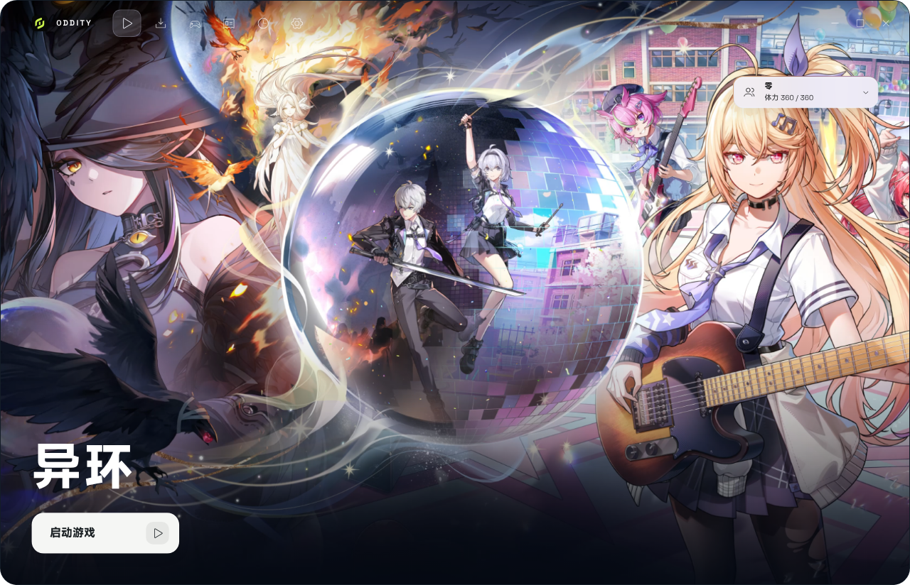

<div align="center">


# Oddity

**《异环》的 Linux 原生启动器**

原生 Wayland / X11 窗口 · 游戏通过 Proton 运行 · 不修改游戏文件

[](https://github.com/LaT-SKY/Oddity/releases)
[](https://github.com/LaT-SKY/Oddity)
[](LICENSE)

</div>



> 功能与界面仍可能调整。遇到问题时请附上系统信息与日志，见[排障指南](docs/troubleshooting.md)。

Oddity 是《异环》的 Linux 启动器：用轻量的原生窗口完成更新检查和游戏启动，游戏本体通过 Proton 运行。Oddity 只替代启动器，不包含游戏本体，不修改游戏文件，也不绕过任何反作弊或登录校验。

## 快速开始

### 1. 准备环境

需要一台 x86_64 Linux 机器，并已准备好：

- WebKitGTK 4.1 与 GTK 3；
- `umu-launcher`（确保终端能运行 `umu-run`）；
- Proton，推荐 GE-Proton 11-5 或更新的版本；
- 通过官方 Windows 客户端安装好的《异环》。

各发行版的依赖安装命令、Proton 与游戏准备步骤见 **[安装指南](docs/install.md)**。

### 2. 构建并安装

```bash
git clone https://github.com/LaT-SKY/Oddity.git
cd Oddity/launcher
cargo build --release -p nte-app
./scripts/install-desktop.sh ./target/release/oddity
./target/release/oddity
```

### 3. 首次启动

1. 打开左侧 **设置**，填写 **游戏安装目录**（安装根目录或其中的 `NTELauncher` 目录均可）。
2. 确认 **Proton 路径** 与 **Wine prefix** 正确。
3. **启动方式** 选择 **官方后台桥接**，点击 **保存设置**。
4. 回到 **启动** 页，点击 **检查更新**，再点击 **启动游戏**。

首次启动的初始化可能需要几分钟，请不要重复点击。更完整的首次配置说明见[安装指南](docs/install.md#首次配置)。

## 系统要求

| 项目 | 要求 |
|---|---|
| 系统 | Linux x86_64，Wayland 或 X11 |
| 图形 | 支持 Vulkan 的显卡驱动 |
| 依赖 | WebKitGTK 4.1、GTK 3、`umu-launcher` |
| 兼容层 | Proton；推荐 GE-Proton 11-5 或更新版本 |
| 游戏 | 已通过官方客户端完成安装 |

Oddity 不提供、不下载游戏本体。开始前请确认目录中存在：

```text
Neverness To Everness/
├── NTELauncher/Config/Config.ini
└── Client/WindowsNoEditor/HT/Binaries/Win64/HTGame.exe
```

## 日常使用

- **启动 / 关闭游戏**：主页按钮会在“启动游戏”“正在启动”“关闭游戏”之间切换。
- **托盘**：启动成功后窗口会收起到托盘；托盘菜单可以显示主界面、隐藏到后台或退出。
- **检查更新**：校验官方启动器文件；游戏资源仍由官方组件在启动时处理。
- **外观**：设置中可以切换亮色 / 暗色主题、主页视频或照片，以及减少动态效果。

## 数据与日志

| 内容 | 路径 |
|---|---|
| 设置 | `~/.config/oddity/settings.json` |
| 启动日志 | `~/.local/share/oddity/logs/nte-app-launch.log` |
| 辅助日志 | `~/.local/share/oddity/logs/helper-window.log` |
| Wine prefix | 默认 `~/.local/share/oddity/prefix` |
| 官方启动器桥接副本 | `~/.local/share/oddity/winroot` |

## 遇到问题

- 启动失败、找不到 Proton、Wine prefix 未初始化、NVIDIA + Wayland 黑屏等常见问题：[排障指南](docs/troubleshooting.md)
- 查看日志、使用命令行诊断、更新或卸载 Oddity：[排障指南](docs/troubleshooting.md#日志与诊断)
- 其他问题：[提交 Issue](https://github.com/LaT-SKY/Oddity/issues)

## 参与贡献

- 提交代码前请阅读 [贡献指南](CONTRIBUTING.md)。
- 安全漏洞请按 [安全政策](SECURITY.md) 私下报告，不要在公开 Issue 中披露细节。

## 许可证

Oddity 以 [GPL-3.0-or-later](LICENSE) 发布，Copyright (C) 2026 LaT-SKY。字体与图标等第三方组件见[第三方组件](THIRD_PARTY.md)。

## 合规

- 仅替代启动器；游戏本体、账号与资源仍来自官方渠道。
- 不修改游戏文件，不注入游戏进程，不绕过 ACE 或其他反作弊。
- 不内置、不分发游戏资源或账号凭据。
- 使用前请自行确认所在地法律与服务条款。

<div align="center">
<sub>Oddity 与《异环》开发/发行方无隶属关系。游戏名称与商标归其权利人所有。</sub>
</div>
