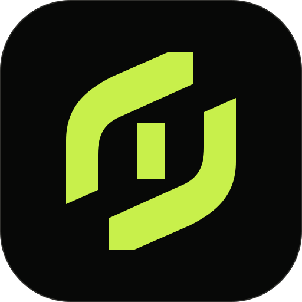
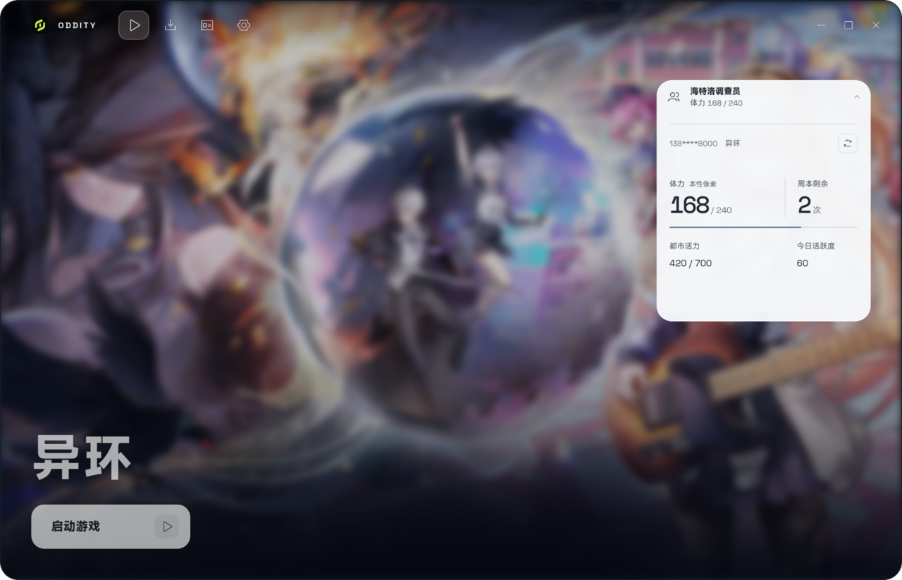

<!--suppress CheckImageSize -->

# Oddity

**《异环》的 Linux 启动器**

*一切正常，就是异常*

  

Oddity 通过 `umu-run` 和 Proton 管理游戏运行环境，并集成了资源检查、下载、校验和启动。

## _Features_

**资源管理**
- 增量更新、断点续传、完整性校验与按需修复。

**多区服支持**
- 国服与国际服独立管理，目录和启动配置互不干扰。

**游戏启动**
- 后台启动、外部启动入口，以及可选的 GameMode、Gamescope 和 MangoHud 集成。

**国服扩展**
- 塔吉多登录、自动签到、体力与周本查询。

**更多体验**
- 官方公告、游玩记录、分享海报与主流手柄支持。

## _Installation_

从 [Releases](https://github.com/LaT-SKY/Oddity/releases) 下载对应安装包：

| _发行版_ | 软件包 |
|:---|:---|
| ArchLinux | [AUR](https://aur.archlinux.org/packages/oddity-bin) / `.pkg.tar.zst` |
| Debian / Ubuntu | `.deb` |
| Fedora / openSUSE | `.rpm` |
| Other | `.AppImage` |

NixOS 和 Gentoo 请参阅 [Nix 指南](docs/nix.md) 与 [Gentoo 指南](docs/gentoo.md)。

安装命令、签名校验及源码构建详见[安装指南](docs/install.md)。

## _Getting Started_

1. 安装 `umu-launcher` 和 Proton，参见[环境准备](docs/install.md#准备游戏环境)。
2. 在 **设置** 中选择区服、游戏目录，并创建 Proton 运行环境。
3. 前往 **更新** 检查资源，完成后即可从 **启动** 页面进入游戏。

首次安装需要下载游戏资源，请预留足够空间。

遇到问题？参阅[排障指南](docs/troubleshooting.md)。

## _Requirements_

- Linux x86_64（Wayland / X11）
- 支持 Vulkan 的显卡及驱动
- `umu-launcher` 和 Proton

## _Preview_

  
  

  
  

# _Technical Differences_

Oddity 针对官方启动器的部分行为进行了改进，重点在于下载可靠性、更新效率与 Linux 兼容性。
- 断点续传：保留已下载的文件及分块，进程中断后只补充缺失部分，避免重新下载完整资源。
- 跨版本更新：基于官方 lastdiff 补丁表搜索更优的多跳更新路径。实测 1.4.14 → 1.4.18 仅需 728.5 MiB，而单跳直补丁约 3.64 GiB。
- 完整性检查：支持快速检查与完整 MD5 校验。检查过程只读，确认后才执行修复，避免直接删除损坏文件。
- Linux 兼容性：修复 GE-Proton 下直接启动游戏时的参数解析问题，默认通过 XWayland 运行。

以上对比基于特定官方版本与测试环境，后续版本的行为可能有所变化。

## _Documentation_

- [安装指南](docs/install.md) — 安装、环境配置与首次运行。
- [排障指南](docs/troubleshooting.md) — 启动异常、资源下载与应急恢复。
- [Proton 运行环境](docs/runtime-environments.md) — A/B 环境、prefix 与快照。
- [外部启动](docs/external-launch.md) — 应用菜单、Steam 与命令行。
- [塔吉多指南](docs/taygedo.md) — 账号登录、自动签到与游戏数据查询。

遇到问题？请前往 [Issues](https://github.com/LaT-SKY/Oddity/issues) 反馈。

## _License_

## License

项目代码采用 [GPL-3.0-or-later](LICENSE) 许可。第三方组件的许可信息见 [THIRD_PARTY.md](THIRD_PARTY.md)，官方游戏美术素材不在 GPL 授权范围内，详见 [ASSETS.md](ASSETS.md)。

Oddity 是第三方项目，与《异环》开发方和发行方无隶属关系。

游戏名称、商标与官方美术素材归其权利人所有。

