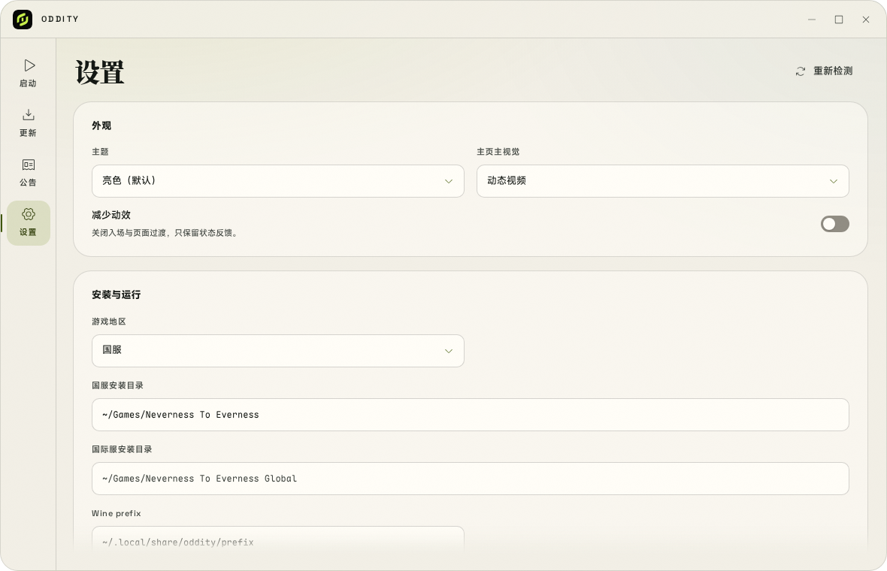
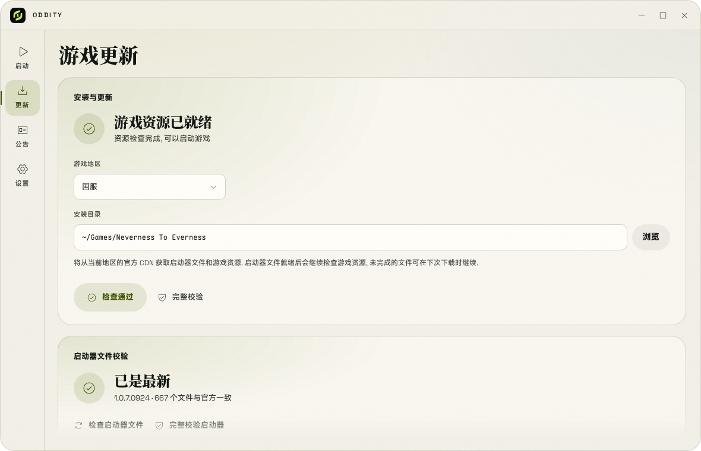
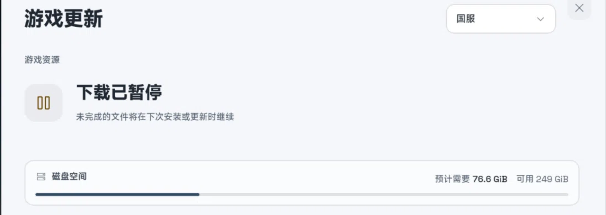
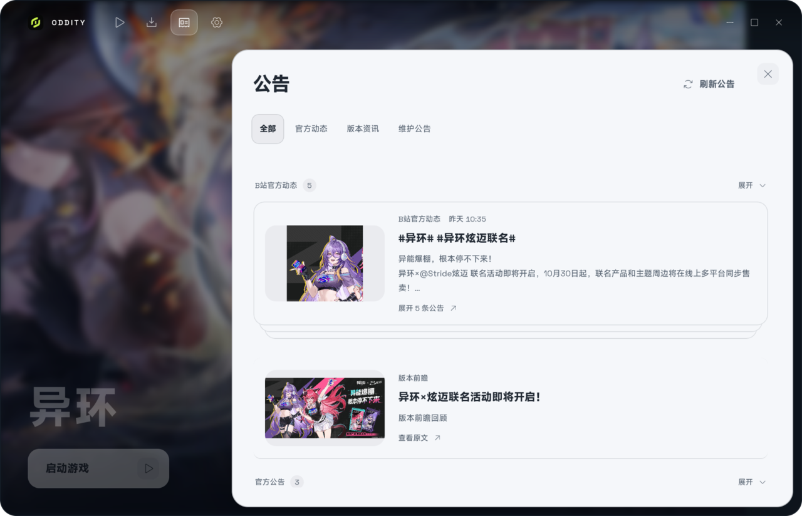

# 安装指南

Oddity 负责资源检查, 下载和启动; 游戏本身仍由 Proton 运行. 下面的顺序按依赖关系排列, 先准备好环境, 再让 Oddity 接管资源和启动.

## 系统要求

| 项目 | 要求 |
| --- | --- |
| 系统 | Linux x86_64, Wayland 或 X11 |
| 运行库 | GTK 3, WebKitGTK 4.1, GStreamer (`gst-plugins-good`), `libsecret`, `xdg-utils` |
| 图形 | 支持 Vulkan 的显卡驱动 |
| 游戏环境 | `umu-launcher`, Proton, 在设置中创建的运行环境 |
| 存储 | 可写的游戏安装目录, 首次安装需要完整游戏资源 |

> 安装包会声明 GTK 3, WebKitGTK 4.1 等必需依赖. `umu-launcher` 在 `.deb` 和 `.rpm` 中为推荐依赖, 在 Arch 包中为可选依赖, 需要确认已经安装.

> 首页视频需要 GStreamer 的 `autodetect` 插件. 缺少 `gst-plugins-good` 时, WebKitGTK 可能在启动后直接退出. `.deb`, `.pkg.tar.zst` (含 AUR) 和 Gentoo 包会声明该依赖; RPM, AppImage 与源码构建请按[排障指南](troubleshooting.md#主页视频无法播放或窗口启动后冻结)检查.

## 安装 Oddity

从 [Releases](https://github.com/LaT-SKY/Oddity/releases) 下载对应格式的包, 在下载目录执行:

| 发行版 | 命令 |
| --- | --- |
| Debian / Ubuntu | `pkexec apt install ./oddity_*_amd64.deb` |
| Fedora | `pkexec dnf install ./oddity-*.x86_64.rpm` |
| openSUSE | `pkexec zypper install ./oddity-*.x86_64.rpm` |
| Arch Linux | `pkexec pacman -U ./oddity-bin-*.pkg.tar.zst` |

包管理器会从已配置的软件源补齐必需依赖. `.deb`, `.rpm` 和 `.pkg.tar.zst` 安装后会注册桌面入口和图标; 各安装包都提供 `nte-cli`.

Arch Linux 也可以从 [AUR](https://aur.archlinux.org/packages/oddity-bin) 安装:

```bash
yay -S oddity-bin
# 或
paru -S oddity-bin
```

AppImage 下载后先赋予执行权限:

```bash
chmod +x ./oddity-*.AppImage
./oddity-*.AppImage
```

若出现 FUSE 错误, 可以解包运行:

```bash
./oddity-*.AppImage --appimage-extract-and-run
```

Nix 和 Gentoo 用户分别参阅 [Nix 指南](nix.md)和 [Gentoo 指南](gentoo.md).

## 准备游戏环境

Oddity 通过 `umu-run` 调用 Proton. 开始前需要安装 `umu-run` 和 Proton, 再在设置中创建运行环境.

### umu-launcher

**Debian / RHEL**

可以从 [umu Releases](https://github.com/Open-Wine-Components/umu-launcher/releases) 获取对应发行版和架构的包, 其他安装方式见[上游说明](https://github.com/Open-Wine-Components/umu-launcher#installing).

**Arch / CachyOS**

Arch 的 `umu-launcher` 位于 [multilib 仓库](https://archlinux.org/packages/multilib/x86_64/umu-launcher/), 需要先确认该仓库已启用:

```bash
sudo pacman -S --needed multilib/umu-launcher
```

若提示找不到仓库或目标, 请检查 `/etc/pacman.conf` 的 `[multilib]` 配置并更新软件包数据库, 仓库启用方法见 [ArchWiki](https://wiki.archlinux.org/title/Official_repositories#multilib).

CachyOS 用户也可以在 `CachyOS Hello` 中选择 `安装游戏软件包`.

**确认**

安装后在终端确认能找到 `umu-run`:

```bash
command -v umu-run
```

若安装在 `~/.local/bin`, 请确认该目录已加入启动 Oddity 时的 `PATH`.

### Proton

推荐使用 GE-Proton. Oddity 已针对其启动参数被 UE 误识别为地图路径而导致的崩溃做处理.

从 [GE-Proton Releases](https://github.com/GloriousEggroll/proton-ge-custom/releases) 下载 Linux x86_64 压缩包, 解压到 `~/.local/share/Steam/compatibilitytools.d/`, 保留压缩包内的 Proton 文件夹.

Oddity 会搜索该目录, 也可以在设置中手动选择解压后的文件夹. 所选目录应同时包含 `proton` 和 `toolmanifest.vdf`, 不要选择 `proton` 文件本身.

游戏还需要正确安装的 Vulkan 显卡驱动, 见 [GE-Proton 环境要求](https://github.com/GloriousEggroll/proton-ge-custom#installation).

### Proton 运行环境

Proton 运行环境保存 Windows 环境和登录状态. 在 **设置 → 运行环境** 点击 **创建运行环境**, 选择已安装的游戏区服, 输入名称, 并选择包含 `proton` 和 `toolmanifest.vdf` 的 Proton 文件夹.

不需要手动填写或初始化 Wine prefix. Oddity 会为每个环境维护独立 prefix, 默认位于 `~/.local/share/oddity/environments/<环境 ID>/prefix`; 首次启动游戏时由 Proton 初始化 Windows 环境. 首个环境会自动设为当前和稳定环境, 启动游戏前必须先创建运行环境.

需要尝试其他 Proton 版本时, 可以[创建独立环境或复制所选环境](runtime-environments.md), 各环境共享游戏资源.

## 首次配置

打开 **设置**, 修改会自动保存. 常用项目位于 **游戏与启动**, 主题与主视觉在 **外观与交互**, 运行环境单独位于 **运行环境**.

| 项目 | 说明 |
| --- | --- |
| 游戏地区 | 国服或国际服. 地区决定资源来源, 启动器程序和公告来源. |
| 国服/国际服安装目录 | 分别设置, 不要让两个区服共用同一目录. |
| 运行环境 | 创建环境并选择包含 `proton` 和 `toolmanifest.vdf` 的 Proton 目录. 不需要手动设置 Wine prefix, 由 Oddity 管理. |
| 启动方式 | 默认使用 **后台启动**. |



> 实际运行截图, 路径与选项以本机环境为准.

在 **设置 → 诊断与维护** 的 **运行诊断** 中可以查看检测结果, 点击设置页右上角的 **重新检测** 刷新.

**已有安装**

可以选择安装根目录或对应的启动器目录:

| 区服 | 启动器配置 |
| --- | --- |
| 国服 | `<安装根目录>/NTELauncher/Config/Config.ini` |
| 国际服 | `<安装根目录>/NTEGlobal/Config/Config.ini` |

**新安装**

先选择一个空目录, 再打开 **更新** 安装资源.

国服和国际服的安装目录互相独立, 切换地区不会移动或覆盖另一区服的文件.

## 安装, 更新与启动

1. 打开 **更新**, 点击 **检查资源**.
2. 按提示点击 **安装游戏** 或 **更新游戏**. 首次安装会先处理启动器文件, 再处理游戏资源.
3. 完成后回到 **启动**, 点击 **启动游戏**.



> 实际运行截图, 资源状态以本机安装为准.

检查完成后, 更新页会显示本轮资源预计需要的磁盘空间, 以及安装目录所在分区的可用空间. 空间不足时会标出缺口; 预算包含下载文件和应用补丁所需的临时空间.



| 启动方式 | 行为 |
| --- | --- |
| **后台启动** (推荐) | 等待官方资源检查并尝试自动启动游戏, 隐藏官方主窗口. |
| **前台启动** | 显示官方窗口, 需要在该窗口中点击启动游戏. |
| **直接启动** | 跳过官方登录, 目前在界面中标为开发中. |

若后台启动出现异常或提示官方组件版本尚未验证, 请改用 **前台启动**.

游戏退出后默认重新显示 Oddity, 可以在设置中关闭 **游戏退出后打开启动器**. 开启 **关闭窗口时最小化到托盘** 后, 关闭主窗口不会退出 Oddity, 可以从托盘菜单重新打开.

## 公告

**公告** 页汇总官方动态, 版本资讯与维护公告, 可以按分类筛选. 同一来源的多条内容默认堆叠为卡叠, 点击展开; 在 **设置 → 外观与交互** 中可以关闭堆叠. 点击条目会在浏览器中打开原文.



> 实际运行截图, 公告内容会随官方更新变化.

## 检查与修复

- **检查资源** 执行快速检查; 通过后按钮显示 **检查通过**.
- **完整校验** 计算文件哈希, 用于检查内容损坏. 发现问题后再点击主按钮修复.
- 下载期间可以点击 **暂停下载**; 重新打开 Oddity 后, 对同一地区和目录重新检查并安装或更新, 可以复用保留的下载文件.
- 资源任务进行中, 地区和安装目录暂时不能修改.
- 首次安装第一阶段显示的是启动器下载量, 不是完整游戏体积.

安装和更新前请确认磁盘有足够空间. 完整资源会占用较大容量, 更新时还需要额外的临时空间.

## 更新 Oddity

手动下载的 `.deb`, `.rpm` 或 `.pkg.tar.zst` 需要重新下载新版, 再执行对应安装命令.

AppImage 需要退出旧版本后替换文件.

从源码运行时, 拉取源码后重复构建与桌面入口安装步骤.

通过 AUR, Nix 或 Gentoo 安装时, 使用对应工具更新.

## 卸载

先在 **设置 → 账号与签到** 中关闭自动签到并移除塔吉多账号, 再退出 Oddity.

通过包管理器安装的版本, 使用同一包管理器卸载; AppImage 删除文件即可.

从源码运行后安装的桌面入口和图标可以按以下命令删除:

```bash
rm -f "${XDG_DATA_HOME:-$HOME/.local/share}/applications/oddity.desktop" \
  "${XDG_DATA_HOME:-$HOME/.local/share}/applications/oddity-recovery.desktop"
rm -f "${XDG_DATA_HOME:-$HOME/.local/share}/icons/hicolor/scalable/apps/oddity.svg"
rm -f "${XDG_DATA_HOME:-$HOME/.local/share}"/icons/hicolor/*/apps/oddity.png
```

配置, 日志和默认前缀不会随上述操作删除, 位置见[排障指南](troubleshooting.md#数据位置).

如需清理, 请先备份; 删除默认前缀也会删除其中的 Windows 环境和登录数据.

## 从源码构建

需要 Rust 工具链, Node.js >= 24.19.0 和 pnpm 12.14.0. Debian / Ubuntu 的构建依赖可以按 [CI 依赖列表](../.github/actions/install-linux-deps/action.yml)安装:

```bash
pkexec apt install build-essential pkg-config libssl-dev libxdo-dev \
  libwebkit2gtk-4.1-dev libgtk-3-dev libayatana-appindicator3-dev \
  librsvg2-dev gstreamer1.0-plugins-good
```

`gst-plugins-good` 是首页视频的运行时依赖, 不参与链接. 其他发行版的包名为 Arch `gst-plugins-good`, Fedora `gstreamer1-plugins-good`, openSUSE `gstreamer-plugins-good`.

在仓库根目录执行:

```bash
git clone https://github.com/LaT-SKY/Oddity.git
cd Oddity/launcher
pnpm --dir ui install --frozen-lockfile
pnpm --dir ui run build
cargo build --release --locked -p nte-app -p nte-cli -p nte-recovery
./scripts/install-desktop.sh ./target/release/oddity
./target/release/oddity
```

发布构建会内嵌前端文件, 所以需要先执行 `pnpm --dir ui run build`. 桌面入口指向构建目录中的可执行文件, 移动源码目录后需要重新运行安装脚本.

## 遇到问题

先查看[排障指南](troubleshooting.md). 主界面无法打开或无法操作时, 先尝试[应急模式](troubleshooting.md#使用应急模式). 提交问题时请附上版本, 发行版, 桌面环境和脱敏日志.
