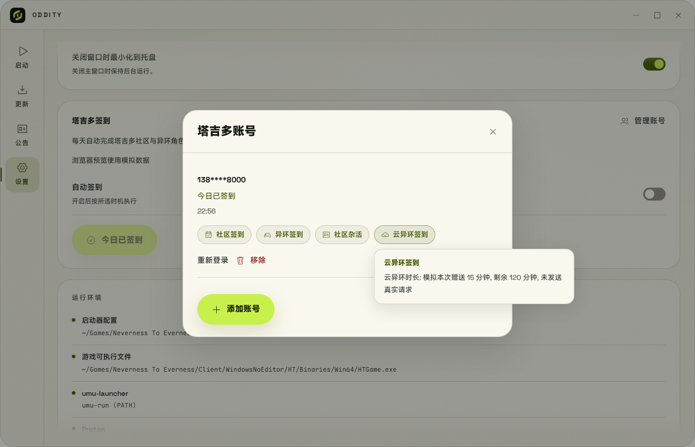

# 塔吉多签到

签到是可选功能, 默认关闭. 支持手机号密码或短信验证码登录, 你可以保存多个塔吉多账号. 所有账号在同一时机执行签到, 账号和会话保存在系统密钥环中.

## 登录与配置

1. 打开设置中的"塔吉多签到". 没有账号时, 主按钮显示"立即登录", 点击打开账号面板.
2. 输入手机号码和密码. 勾选"保存密码"后, 会话失效时会尝试自动恢复; 默认只保存会话凭据.
   也可以切换到"短信验证码", 输入手机号并点击"发送验证码", 收到短信后输入验证码登录. 发送成功后需等待 60 秒才能重新发送. 短信登录不新增保存密码, 已有的保存密码会保留.
3. 登录后点击"管理账号"可以继续添加账号、重新登录或移除账号. 所有账号都会参与自动签到.
4. 打开"自动签到", 选择时机. 签到设置会随修改自动保存, 没有单独的保存按钮.
5. 点击"立即签到"执行. 当天全部账号成功后, 按钮变为"今日已签到"并禁用. 部分失败时按钮仍可重试, 设置页只显示汇总, 具体原因在账号面板中.

首次使用可以运行 `nte-cli keyring-check` 检测 Keyring, 不读取已有账号.

## 启动页游戏状态

启动页通过右上角的"体力与周本"胶囊打开国服游戏状态浮层, 默认收起.
每个账号一条角色记录, 包含体力 (本性像素)、周本剩余次数、都市活力和今日活跃度,
以及角色名称和脱敏手机号. 所有已登录账号均可通过底部左右按钮切换查看,
按钮聚焦时也可使用左右方向键. 面板不支持横向或竖向滚动.
点击胶囊、面板外部或按 Esc 可收起, Motion for Vue 负责弹性开合与账号切换动画,
并遵循系统和启动器的减少动态效果偏好.
此功能与自动签到开关独立, 读取状态不会执行签到、金币任务或领取云异环时长.

首页可见时每 30 分钟查询一次, 也可点击面板右上角的刷新按钮.
没有账号时点击"前往设置登录"复用现有登录入口. 国际服不支持塔吉多查询, 切换国际服后隐藏面板和登录入口, 后端拒绝国际服视图中的塔吉多登录、查询与签到请求. 已配置的国服定时任务独立保留.

缺失或无效字段显示 `--`, 数值 `0` 正常显示. 单账号失败不影响其他账号, 查询失败时保留上次数据并显示原因;
会话失效时可前往设置重新登录. 查询与登录、签到共用账号操作锁, 任务冲突时提示稍后重试.
面板非敏感数据缓存在权限为 `0600` 的签到状态文件中, 凭据仍仅保存在系统密钥环.

同一手机号重新登录会复用设备身份. 密码输入框在请求结束后清空, 后端不把密码或令牌返回界面, 也不输出原始认证响应.

## 账号与签到状态

设置页通过"管理账号"打开账号面板, 账号数量与详细信息在面板中查看.

- 今日已签到: 当天该账号签到成功.
- 今日未签到: 当天尚未执行.
- 签到失败: 当天执行过但未全部成功, 显示第一条失败原因.
- 需要重新登录: 会话失效或需要人工验证, 自动签到会跳过该账号, 不影响其他账号.

移除最后一个账号会关闭自动签到并删除 systemd 定时器; 移除其他账号不会改变签到设置.

异环角色名称在执行签到时从角色接口的 `roleName` 字段读取, 保存到签到结果并显示在"异环签到"胶囊的提示中; 名称缺失时显示角色 ID. 已保存的签到记录保留当次接口返回的信息.

## 金币任务与云异环时长

每次执行签到都会默认尝试金币任务和领取云异环每日时长, 不提供单独设置. 金币任务先读取今日剩余次数, 再执行 BBS 签到、浏览推荐帖子、点赞未点赞帖子和分享帖子, 分享平台固定为 QQ, 最后读取今日金币状态. 浏览和点赞之间保留短暂随机间隔, 账号仍按顺序执行.

云异环优先复用 Keyring 中保存的老虎令牌和用户标识. 缺少任一凭据时, 仅在已保存密码的情况下尝试密码登录, 将新凭据保存到 Keyring 后查询时长; 未保存密码时显示跳过. 短信登录获得的老虎会话也可直接使用. 账号面板以胶囊标签显示已完成的社区签到、异环签到、社区杂活和云异环签到, 各类使用不同图标. 异环全部角色完成、社区杂活各项完成后才显示对应标签. 金币与时长在悬停提示中查看, 失败与跳过原因单独显示. CLI 和 systemd 日志也会输出.

金币或云时长任务失败会保留具体结果, 不影响 APP 和异环游戏签到的成功状态, 也不会将塔吉多账号标为需要重新登录. 当天核心签到已成功的账号会跳过后续手动和自动触发, 附加任务不会在当天单独补跑. 签到会话准备失败时不执行附加任务.

账号管理预览 (模拟账号与奖励数据):



## 签到时机

| 选项     | 行为                         |
|--------|----------------------------|
| 关闭     | 不自动签到, 不启用用户定时器; 可以手动执行    |
| 启动器打开时 | 启动器进程启动后在后台执行, 不阻塞主界面或游戏启动 |
| 开机时    | 用户登录后通过 systemd 用户定时器执行一次 |
| 每天定时   | 按设置的北京时间通过 systemd 用户定时器执行 |
| 仅手动    | 只在点击"立即签到"或运行 CLI 时执行      |

开启时默认选择"启动器打开时". 自动执行按北京时间自然日逐个账号去重, 已成功的账号跳过后续自动触发. 网络或普通业务错误保留该账号的失败记录, 可手动重试或等待下次触发. 登录失效或需要人工验证时只暂停该账号, 其他账号继续. 显示托盘中已运行的窗口不算重新启动.

开机时和每日定时需要 systemd 用户管理器运行, 并且 Keyring 可访问. 退出启动器后可以执行, 关机或退出用户会话时无法执行. 开机时在用户登录后约 45 秒触发, 并随机延后最多 30 秒; 每日定时的 `Persistent=true` 会在会话恢复后补一次任务, 只能领取当日可用的奖励, 时间可能随机延后最多 60 秒. Oddity 不会自行启用 linger 或解锁密钥环.

切换到启动器打开时、仅手动或关闭会停止并移除定时器. 更新或移动 Oddity 可执行文件后, 应重新选择一次每日定时设置. 卸载前先关闭定时签到. 移除最后一个账号会停止定时器、删除 Keyring 凭据并清除账号状态.

## Keyring 与会话

Linux 使用 Secret Service, 可对接提供该接口的 GNOME Keyring 或 KWallet. 若密钥环未启动、被锁定或拒绝访问, 操作会报告错误. 不会把凭据改存到明文文件.

账号凭据使用服务名 `io.github.oddity.Launcher.taygedo`, 条目标识由配置目录生成. 一个条目的秘密值保存账号数组, 每个账号包含完整手机号、可选密码、设备身份和登录令牌. 普通配置位于 `~/.config/oddity/taygedo/state.json`, 跟随 `XDG_CONFIG_HOME`, 只包含脱敏手机号、是否记住密码、签到选项、各账号的错误类别和结果. 文件权限为 `0600`.

执行签到前先刷新会话. 明确的认证失效允许使用已保存的老虎会话重建; 再次失效时, 只有用户选择记住密码才会尝试一次密码登录. 人工验证错误不进入自动重登分支. 新令牌保存到 Keyring 成功后才执行签到. 所有入口使用同一个文件锁.

## 人工验证与实际测试

登录接口提示人机验证、图形验证码或风控时, Oddity 在对应账号上显示需要人工处理并暂停该账号的自动尝试. 当前没有内嵌滑块或图形验证窗口, 也不会自动解题. 请在官方渠道完成要求后重新登录; 是否可以在 Oddity 内接入官方验证页面, 需要结合真实返回的挑战流程确认.

协议主要参考仍在维护的 [taygedo-auto-attendance](https://github.com/zzstar101/taygedo-auto-attendance). 本地测试不能证明真实账号登录成功或奖励到账. 首次验收需要确认手机号密码登录、短信验证码登录、实际 Keyring 持久化、多账号执行、会话刷新和奖励领取结果. 不要将密码、令牌或原始认证响应发到公开 Issue.

## 命令行诊断

```bash
# 检测本机 Keyring, 不需要游戏目录
./launcher/target/debug/nte-cli keyring-check

# 使用界面中已登录的账号执行一次签到, 按账号输出结果
./launcher/target/debug/nte-cli attendance

# 定时器、开机定时器与执行日志
systemctl --user status oddity-taygedo.timer
systemctl --user status oddity-taygedo-boot.timer
systemctl --user status oddity-taygedo.service
journalctl --user -u oddity-taygedo.service
```

CLI 支持 `attendance --config <签到配置目录>`, 配置目录也决定 Keyring 条目标识. 部分失败返回非零退出码. 服务使用 `oddity --taygedo-attendance` 无界面入口, 不创建 WebView, 不要求安装 CLI.

浏览器预览使用模拟登录、Keyring 和签到, 不发送真实请求; 请在原生 Oddity 窗口测试真实账号.
