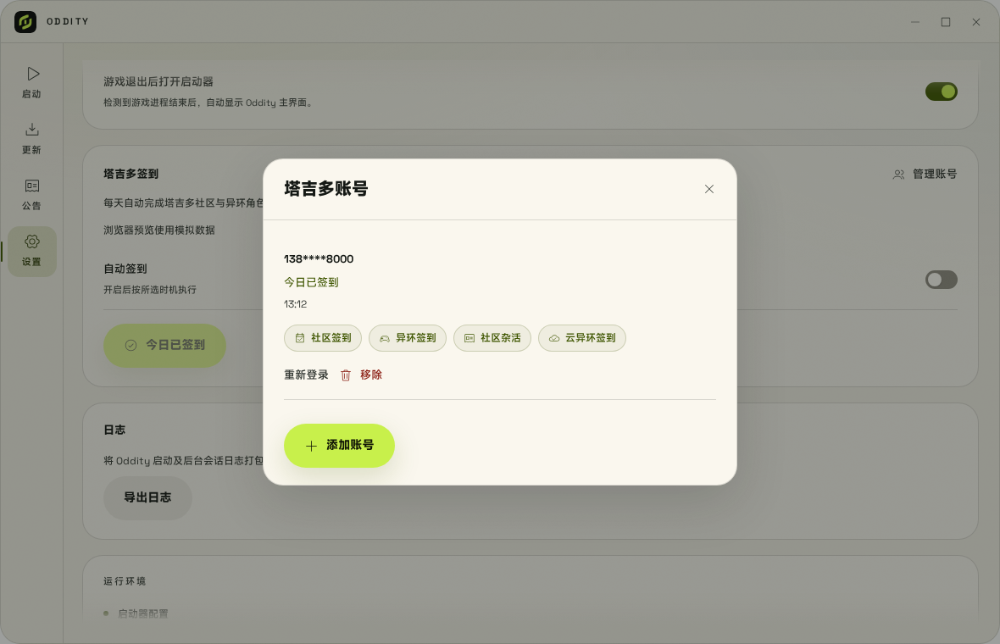

# 塔吉多指南

塔吉多登录, 签到和游戏状态查询仅在国服提供.

## 登录与账号管理

1. 打开 **设置 → 塔吉多签到**, 点击 **立即登录**.
2. 选择手机号密码登录或短信验证码登录.
3. 登录后通过 **管理账号** 添加或移除账号.

凭据保存在系统密钥环中, 使用前需要启动并解锁支持 Secret Service 的密钥环. 勾选 **记住密码** 后, 密码也会保存在密钥环中, 用于会话失效后的自动重登尝试.

需要人机验证时, 请先在官方渠道处理, 再回到 Oddity 重新登录.



> 浏览器预览, 账号, 任务与奖励为模拟数据.

## 签到

点击 **立即签到** 可以执行账号任务, 结果在账号面板中查看.

执行时会尝试社区签到, 异环签到, 金币任务和云异环每日时长领取.

金币任务包含浏览, 点赞和分享帖子; 如果不希望执行这些操作, 请不要触发签到.

云异环凭据不足且未保存密码时, 时长任务会显示跳过.

奖励数值与成功状态以服务返回及账号面板结果为准. 当天完成的任务会跳过; 未完成的附加任务可以在下次自动触发或运行 `nte-cli attendance` 时重试.

登录失效或需要人工验证的账号会暂停尝试, 需要重新登录.

## 自动执行

| 模式     | 行为               |
|--------|------------------|
| 关闭自动签到 | 不自动执行.           |
| 启动器打开时 | 启动 Oddity 进程后执行. |
| 开机时    | 用户登录后触发.         |
| 每天定时   | 按设置的北京时间触发.      |
| 仅手动    | 通过按钮或命令行执行.      |

开机和每日定时模式依赖 systemd 用户定时器及可访问的密钥环, 退出 Oddity 窗口后也可以执行.

每日定时启用错过任务补触发, 但不补领往日奖励.

自动任务可能有随机延迟, 不保证在指定时刻立即完成.

移动可执行文件后需要重新设置定时任务; 卸载前请先关闭自动签到.

## 体力与周本

在 **启动** 页点击 **体力与周本** 打开游戏状态面板.

可以查看体力, 周本剩余次数, 都市活力与今日活跃度, 并切换已登录账号.

主页可见时每 30 分钟查询一次, 也可以点击刷新按钮. 查询状态不会执行签到或领取奖励.


> 浏览器预览, 角色与数值为模拟数据. 游戏状态来自官方接口.

## 常见问题

- **无法访问 Keyring**: 先启动并解锁桌面密钥环, 再重试.
- **需要重新登录**: 在账号管理中重新登录该账号.
- **定时任务没有执行**: 检查用户定时器和服务日志:

```bash
systemctl --user status oddity-taygedo.timer oddity-taygedo-boot.timer
journalctl --user -u oddity-taygedo.service
```

需要检查密钥环时, 可以运行 `nte-cli keyring-check`; 该命令读写并删除独立临时条目, 不读取已保存账号.
