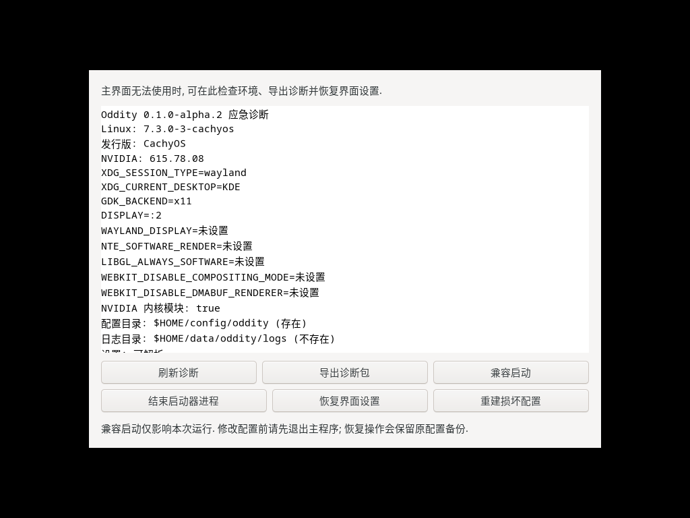

# 排障指南

先打开 **设置 → 诊断与维护** 查看 **运行诊断**, 点击设置页右上角的 **重新检测** 刷新. 下面按现象分类.

| 现象                       | 先检查         |
|--------------------------|-------------|
| 提示找不到游戏或启动器配置            | 地区与安装目录     |
| 提示找不到 `umu-run` 或 Proton | 路径与 `PATH`  |
| 提示 Wine prefix 尚未初始化     | `drive_c`   |
| 窗口黑屏, 花屏或闪退              | 软件渲染开关与显卡驱动 |
| 游戏启动失败或卡住                | 日志, 权限与启动方式 |
| 下载中断或校验失败                | 磁盘空间, 网络与续传 |

## 三项快速检查

在终端执行:

```bash
command -v umu-run
ls /path/to/Proton/proton /path/to/Proton/toolmanifest.vdf
ls -d ~/.local/share/oddity/environments/环境ID/prefix/drive_c
```

请将示例中的 Proton 路径和 prefix 路径替换为实际路径. prefix 由 Oddity 管理, 不需要手动创建; 首次启动前这一项可能还不存在, 完成一次启动后再检查. 三项都存在时, 再往下看具体现象.

## 启动器

### 找不到启动器配置

已有安装请选择安装根目录或启动器目录, 并确认对应配置存在:

- 国服: `<安装根目录>/NTELauncher/Config/Config.ini`.
- 国际服: `<安装根目录>/NTEGlobal/Config/Config.ini`.

新安装先在 **更新** 页点击 **检查资源**, 再按提示安装.

如果目录里有游戏文件但 Oddity 仍识别不到, 确认设置中的 **游戏地区** 与目录一致, 不要在一个目录里混放两个区服.

### 找不到 umu-run 或 Proton

若终端能找到 `umu-run` 而 Oddity 找不到, 请检查启动 Oddity 时的 `PATH`.

创建运行环境时应选择 Proton 安装目录, 不要选择 `proton` 文件. 该目录需要同时包含 `proton` 和 `toolmanifest.vdf`.

### Wine prefix 尚未初始化

请先按[安装指南](install.md#proton-运行环境)在 **设置 → 运行环境** 中创建 Proton 运行环境. 不需要手动设置 Wine prefix, 创建环境后由 Oddity 管理. 首次启动时由 Proton 初始化前缀. 若环境目录损坏或被移除, 请创建新环境后切换使用.

### 使用应急模式

主界面无法打开或无法操作时, 可以先用应急模式启动 Oddity:

1. 从应用菜单打开 **Oddity 应急恢复**, 或运行 `oddity --recovery`; AppImage 运行 `./oddity-*.AppImage --recovery`.
2. 在应急窗口点击 **兼容启动**.



> 实际运行截图, 诊断内容以本机环境为准.

兼容启动只影响本次运行, 使用静态背景和保守渲染设置. 若仍无法显示, 可以在同一窗口刷新诊断, 导出诊断包或恢复界面设置; 恢复前退出主程序, 原设置会备份. 应急窗口不依赖 Electron, 也可以直接运行 `oddity-recovery`.

### 窗口黑屏, 花屏或闪退

先按上一节尝试应急模式. 也可以从终端尝试软件渲染开关:

```bash
NTE_SOFTWARE_RENDER=1 oddity
```

将 `oddity` 换成实际可执行文件路径. 若两种方式结果不同, 提交问题时附上显卡型号, 驱动版本和 Wayland/X11 会话类型.

### 主页视频无法播放或窗口启动后冻结

确认正在使用完整发行目录, 其中包含 `libffmpeg.so`、`resources/app.asar` 和 `resources/bin/oddity-backend`. 单独复制主程序会缺少必要资源.

先通过 `oddity --recovery` 打开应急恢复, 查看启动日志. 同时记录显卡型号、驱动版本、Wayland/X11 会话和窗口所在屏幕. 可以使用 `NTE_SOFTWARE_RENDER=1 oddity` 对比图形驱动路径.

如果只是视频无法播放, 界面仍可操作, 也可以在 **设置 → 外观与交互 → 主页主视觉** 中选择 **静态照片** 临时规避.

Debian, Arch 和 Gentoo 安装包会声明该依赖; AppImage, RPM 和源码构建不保证自带该插件, 需要结合系统环境确认. Nix 包已包含插件.

### 关闭窗口后 Oddity 没有退出

如果开启了 **关闭窗口时最小化到托盘**, 关闭主窗口只会隐藏到后台. 可以从托盘菜单选择 **退出 Oddity**, 或在设置中关闭该选项.

### 桌面入口打开后提示无法连接 127.0.0.1

这通常出现在从源码运行后直接安装桌面入口的情况. 发布版会内嵌前端文件, 开发模式则依赖 Vite 服务. 处理方式见[安装指南](install.md#从源码构建).

### 桌面动作没有启动游戏

先确认启动失败时是否出现 `异环启动失败` 或 `NTE 启动失败` 桌面通知. 没有通知时检查当前桌面是否提供 `org.freedesktop.Notifications`, 并查看 `~/.local/share/oddity/logs/` 下的启动日志.

如果提示需要创建运行环境, 先在 **设置 → 运行环境** 中选择对应地区并创建环境. 同一地区有多个环境时, 使用 `oddity --launch --region ... --environment <名称>` 指定. 详细参数见[外部启动入口](external-launch.md).

## 游戏

### 游戏启动失败或卡住

1. 在 **设置 → 诊断与维护 → 环境快照** 中对比当前环境与上次成功启动. 快照会列出 Oddity 版本, Proton, 显卡驱动, 桌面会话和运行环境等变化; 显示为未采集的项表示本次没有读到, 不等于发生变化.
2. 查看启动日志和辅助日志的末尾, 详细位置见[数据位置](#数据位置).
3. 若日志提示运行配置不可写, 优先检查游戏目录中 `GameLauncher.config` 和 `patchersdk_serverlist` 的权限.
4. 若日志提示找不到可用服务器, 优先检查游戏目录的权限.
5. 若后台启动失败或提示组件版本尚未验证, 切换 **前台启动** 查看官方窗口.
6. 若怀疑文件损坏, 在 **更新** 中执行 **完整校验**, 再修复资源.

后台启动期间, 首页启动按钮会显示当前阶段, 右侧子按钮可以暂停启动. 暂停后官方后台进程会被清理, 可以重新启动.

### 下载中断或校验失败

重新打开 Oddity 后, 对同一地区和目录重新点击 **检查资源**, 再继续安装或更新, 已经下载的文件会尽量复用.

若反复中断, 检查磁盘剩余空间和网络连接, 或先暂停下载, 等网络稳定后继续. 完整校验失败时, 按界面提示修复对应资源.

### 游戏退出后没有回到 Oddity

确认设置中的 **游戏退出后打开启动器** 已开启. 若关闭了该选项, Oddity 会留在托盘, 可以从托盘菜单打开主界面.

## 日志与数据

### 导出日志

在 **设置 → 诊断与维护 → 导出日志** 中发起隐私检查. Oddity 会显示文件数量, 敏感信息命中次数和脱敏片段; 确认后点击 **保存脱敏日志** 并选择保存目录, 将已检查的日志打包为 ZIP. 预览期间新增的日志不会加入这次导出, 本地原始日志保持不变.

桌面端, 应急界面和 CLI 导出均会替换当前用户主目录, 可识别的大陆手机号, 认证字段及 URL 用户信息中的凭据, JWT 令牌. 日志统一转换为 UTF-8; 支持带 BOM 的 UTF-16, 无效字符使用替代字符显示. 无法识别的二进制内容或超过 4 MiB 的单行会导致检查失败, 不会原样导出.

自动识别无法覆盖所有隐私内容. 分享前仍请检查账号信息, 非标准格式的凭据以及不希望公开的其他本机路径.

### 环境快照

Oddity 在每次实际启动游戏前记录一份环境快照, 并在游戏进程连续运行满设置中的判定时长后把本次启动记为成功, 作为自动基准. 判定时长默认为 1 分钟, 可以在 **设置 → 诊断与维护 → 环境快照** 中选择 1, 5, 10 或 30 分钟, 修改后下次启动生效. 对比时以实时读取的当前环境与自动基准或参考快照比较, 只报告字段变化, 不自动切换环境.

参考快照可以把当前环境固定下来长期保留, 不会随之后的成功启动或历史裁剪变化; 同一时间只保留一份, 可以替换或删除. **清除启动历史** 只删除启动记录和自动基准, 参考快照会保留.

快照保存在本机, 只包含启动参数和可读取的系统信息, 不读取 prefix 内部文件或游戏文件. 无法读取的字段显示为未采集, 不参与变化判定. OpenGL 驱动版本来自 glxinfo; 未安装该工具时该项显示为未采集, 不影响其他字段. 快照包含本机路径, 分享截图前请检查. 当前版本不会把快照文件加入脱敏日志导出.

### 数据位置

以下为未设置 XDG 目录变量时的路径:

| 内容          | 默认位置                                            |
|-------------|-------------------------------------------------|
| 设置          | `~/.config/oddity/settings.json`                |
| 签到状态        | `~/.config/oddity/taygedo/state.json`           |
| 日志目录        | `~/.local/share/oddity/logs/`                   |
| 游玩记录        | `~/.local/share/oddity/playtime.json`          |
| 环境快照        | `~/.local/share/oddity/environment-snapshots.json` |
| 启动日志        | `~/.local/share/oddity/logs/environments/<环境 ID>/nte-app-launch.log` |
| 辅助日志        | `~/.local/share/oddity/logs/environments/<环境 ID>/helper-window.log`  |
| Wine prefix | `~/.local/share/oddity/environments/<环境 ID>/prefix`                  |

配置和数据目录分别跟随 `XDG_CONFIG_HOME`, `XDG_DATA_HOME`.

Wine prefix 由所选运行环境决定. 运行环境页会显示当前 prefix 的实际位置.

### 命令行诊断

安装包提供 `nte-cli`, 可以在不打开界面的情况下检查配置和资源:

| 命令                                            | 用途               |
|-----------------------------------------------|------------------|
| `nte-cli recovery diagnose`                    | 检查 Oddity 环境, 无需游戏目录. |
| `nte-cli recovery start-compatible`            | 以兼容模式启动 Oddity.   |
| `nte-cli doctor --root <启动器目录>`               | 显示启动器配置和运行环境.    |
| `nte-cli game-check --root <启动器目录> --full`    | 完整检查游戏资源.        |
| `nte-cli game-apply --root <启动器目录> --dry-run` | 预览更新计划, 不写入游戏文件. |

示例中的 `<启动器目录>` 请替换为实际路径. 除 `start-compatible` 会启动兼容模式外, 以上命令只读取配置或预览更新, 不会写入游戏文件.

## 提交问题

请在 [Issues](https://github.com/LaT-SKY/Oddity/issues) 提供:

- Oddity 版本.
- 发行版和桌面环境.
- 显卡型号与驱动版本.
- Wayland 或 X11 会话类型.
- 若启动失败, 附上环境快照的对比结果; 快照包含本机路径, 分享前请检查.
- 复现步骤与脱敏日志.

安全漏洞请按[安全政策](../SECURITY.md)私下报告.
